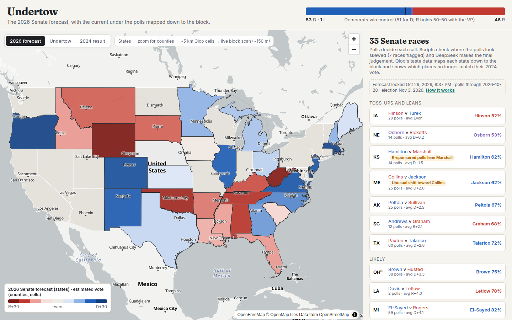
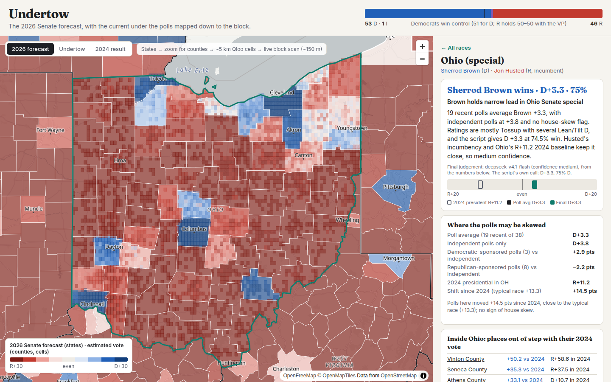
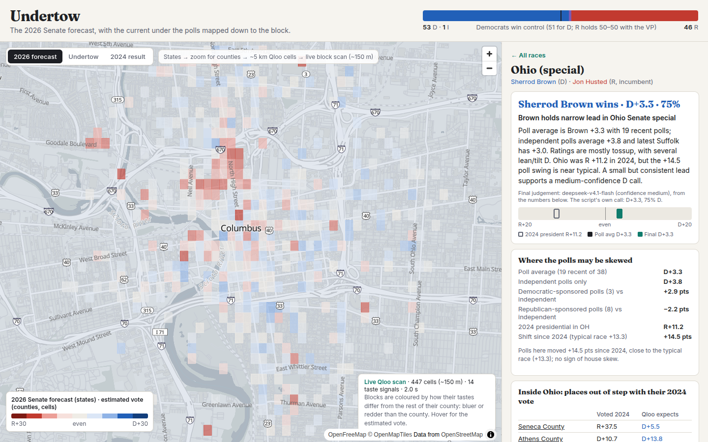

# Undertow

**The 2026 Senate forecast, with the current under the polls mapped down to the block.**
Qloo Agentic Hackathon 2026 entry.

Polls tell you who is ahead. Undertow adds the *where*: Qloo knows what people in every corner of the country watch, read, listen to and buy. We learned which tastes go with how a county votes, and used that to map each state from counties down to ~150 m blocks. The map also shows which places no longer match their 2024 vote.



## What it does

- **Forecasts all 35 Senate races and 36 governor races of Nov 3, 2026.** Recent general-election polls make each call, weighted by recency and sample size, with one poll per pollster and partisan-sponsored polls counted at 60%. Races with no polls start from the 2024 result plus the typical shift seen in polled races.
- **Looks for skew in the polls.** A script checks two things: whether Democratic- or Republican-sponsored polls differ from independent ones by 4+ points, and whether a race's shift since 2024 is far (9+ points) from the typical race.
- **Uses an LLM for the final judgement only.** Undertow AI (an LLM) reads the script's numbers and published race ratings, then makes the call with a short reason. It has no tools. Its answer is validated (party, probability range, at most 8 points from the script's call), and the script's call stands in if it fails.
- **Maps it all on four levels.** States, then counties, then Qloo's ~5 km heat cells, then a **live block-level scan (~150 m)** that calls Qloo for whatever neighbourhood you zoom into.
- **Two comparison sliders.** Drag a line across the map to compare the **2026 forecast with the 2024 presidential result**, or the **polls forecast with a Qloo-only forecast**. The Qloo-only map is what each place's tastes alone predict, from the nationwide taste model, plus the national shift the polls show. On 2024 that model missed states by 6.6 pts on average and picked the right winner in 94% of them.
- **A Tools panel, "Where we disagree."** It lists races where our call differs from the poll average, the Qloo-only forecast or Polymarket's odds (shown for comparison only and never used in the forecast). It also checks our county estimates against Polymarket's county markets and lists the counties most out of step with their 2024 vote.
- **Guided tour.** One minute, from the welcome window: the map flies to the places where Qloo's tastes tell a different story (the 2024 map redrawn from tastes alone, the statewide undertow, Miami-Dade, the race where polls and tastes disagree, a block-level scan) and ends at the charts.
- **Charts below the map (D3).** Our call vs the Qloo-only forecast for every race; Qloo vs the actual 2024 result by state or county; the 2020→2024 county test in ten bins (counties whose tastes were bluer than their vote did swing toward Democrats, by fractions of a point); and the statewide test that failed.
- **Qloo ↔ 2024 actual slider.** The 2024 map that tastes alone predict, next to what really happened (right winner in 45 of 48 states).
- **ZIP code and city search.** Jump to any place; the map flies there, opens the state's race and runs a live block scan.
- **Covers governor races too.** All 36, through the same pipeline.
- **Shows where the "undertow" is.** These are counties whose tastes say they should vote differently from how they did in 2024, measured relative to their state.

| Ohio: counties and ~5 km Qloo cells | Live block scan, downtown Columbus (~150 m) |
|---|---|
|  |  |

## How the Qloo part works (and what we tested)

1. **Taste maps.** For 77 tastes (TV shows, podcasts, media figures, artists, brands, films), we pulled Qloo heatmaps (`/v2/insights`, `filter.type=urn:heatmap`) for every state, about 3,900 requests. They are mapped onto 3,105 counties.
2. **Taste → vote model.** A taste is only used if its link to the county vote, after removing county size, points the same way in at least 80% of states. Strongest tastes: Duck Dynasty, Donald Trump Jr., Dan Bongino, Hannity → R; Beyoncé, Kendrick Lamar, Moonlight, Succession → D. Every county's expected vote comes from a ridge model that **never saw its state** (leave-one-state-out).
   - Ranking counties by how they voted: county size alone r ≈ 0.55; with Qloo r ≈ 0.64 (state-level maps) and **0.73** (nationwide maps).
3. **The undertow, tested on the past.** We fit to 2020 results and asked whether out-of-step counties swung the flagged way in 2024.
   - *Inside a state:* yes in 34 of 50 states, but weakly (56% on the most extreme counties). **Used for the map.**
   - *Statewide:* no. Across 49 states, r = −0.17 after controlling for the 2020 margin, and the most out-of-step states moved the flagged way 50% of the time. **So Qloo does not move any statewide call.** That would have added noise to the predictions.
   - Caveat: Qloo's data reflects tastes today, not in 2020, so the county result is not a clean forecast test.
4. **Below the county.** A cell or block shows its county's result shifted by how its tastes differ from its neighbours'. It's relative, not a separate poll.

The app's "How it works" panel shows all of these numbers live from the model files.

## Run it

```bash
python3 -m venv .venv && .venv/bin/pip install -r app/requirements.txt pandas scipy beautifulsoup4 lxml
scripts/get_data.sh                                   # public county results + shapes
# Qloo calls: pipeline/qfetch.py sends requests through a host that holds the key (see pipeline/qfetch_remote.sh)
.venv/bin/python pipeline/collect_states.py           # Qloo state heatmaps -> data/qloo/states/
.venv/bin/python pipeline/model.py                    # county model, undertow, cell layers -> data/model/
.venv/bin/python pipeline/national.py                 # nationwide features + statewide backtest
.venv/bin/python pipeline/polls.py --office senate    # Wikipedia general-election polls -> data/polls/
.venv/bin/python pipeline/forecast.py                 # script calls + skew checks -> data/forecast/script.json
.venv/bin/python pipeline/synth.py --lock             # Undertow AI final judgement -> data/forecast/senate.json
QLOO_API_KEY=... .venv/bin/uvicorn app.server:app --port 3090   # QLOO_API_KEY enables live block scans
```

The repo includes the processed model outputs (`data/model/`) and the forecast (`data/forecast/`), so the app runs without re-running the pipeline. Raw Qloo API responses are not included.

## Data

- **Qloo Insights API**, hackathon endpoint: heatmaps and search.
- **Polls:** Wikipedia general-election polling tables for each 2026 Senate race.
- **2020/2024 county presidential results:** [tonmcg/US_County_Level_Election_Results_08-24](https://github.com/tonmcg/US_County_Level_Election_Results_08-24).
- **County shapes:** [us-atlas](https://github.com/topojson/us-atlas).
- **ZIP and city search:** [GeoNames](https://www.geonames.org/) US postal codes (CC BY 4.0), bundled in `data/geo/`.
- **Basemap:** OpenFreeMap / OpenStreetMap.
- **Polymarket** (public gamma API) odds appear in the Tools panel for comparison only. They never feed the forecast.

## Limits

- A forecast, not a certainty. Close races are close.
- Qloo signals describe tastes, not individual voters. Cells and blocks are estimates relative to their county.
- Polls come from Wikipedia's tables, and some races have few or no polls.

MIT licence.
